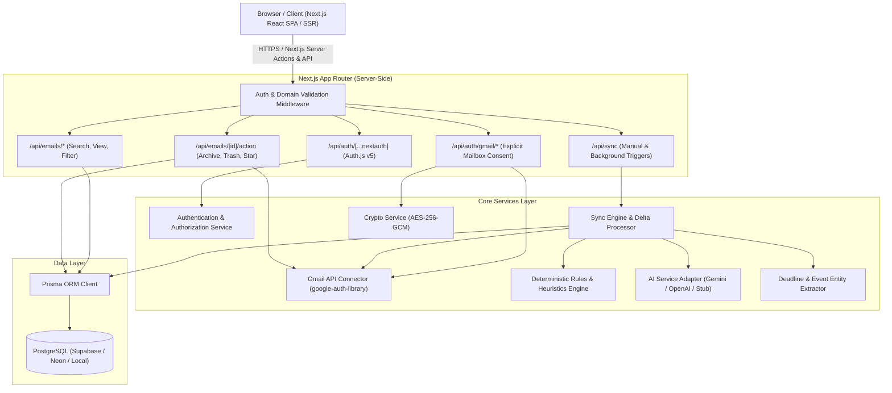

# Architecture Specification: SigmaMail

**System Version:** 1.0.0-draft  
**Status:** Planning & Architecture Baseline  
**Author:** Lead Software Architect & Senior Full-Stack Engineer  

---

## 1. System Overview & Core Principles

SigmaMail is a web application designed to help university students organize, prioritize, and act upon academic, examination, placement, and club communications received via Google Workspace / Gmail.

### Core Architectural Tenets
1. **Separation of Identity vs. Mailbox Authorization:**
   - Identity verification (Google Sign-In) only authenticates the user's `@vitapstudent.ac.in` profile (`openid`, `email`, `profile`).
   - Gmail Mailbox Access is a **separate, explicit opt-in step** with clearly explained scopes (`gmail.readonly` vs `gmail.modify`). Users can revoke mailbox sync without losing their account.
2. **Zero-Knowledge Token Architecture:**
   - Refresh and access tokens for Gmail are **never exposed to the browser/client-side bundle**.
   - All external API tokens are encrypted at rest using authenticated symmetric encryption (**AES-256-GCM**) with cryptographic authentication tags.
3. **Decoupled Provider-Agnostic AI Pipeline:**
   - Classification, summarization, and deadline extraction operate through a unified TypeScript interface (`AIServiceInterface`).
   - A deterministic rules-first heuristics engine handles immediate categorization without AI latency or cost; AI is invoked asynchronously for ambiguous, unstructured, or long-form emails.
4. **Resilient Synchronization & Idempotency:**
   - Synchronization employs Gmail History API cursors (`historyId`) with exponential backoff and incremental delta fetching.
   - All inbound webhook/sync worker tasks are idempotent to prevent duplicate email records or redundant deadline extractions.

---

## 2. High-Level System Architecture



---

## 3. Layered Component Responsibilities

### 3.1 Frontend Layer (Next.js App Router + React + Tailwind + shadcn/ui)
- **Server Components (`app/(dashboard)/...`)**: Fetch initial email feeds, categorization views, metrics, and user preferences directly on the server without client watermarking.
- **Client Components (`components/...`)**: Provide responsive interactions (optimistic archive/trash UI, fast search input with debouncing, modal previews, deadline calendar drawers).
- **State Management**: Lightweight URL state (`nuqs` or Next.js `useSearchParams`) for filters (category, importance, date, tag) + React Server Actions for mutations.

### 3.2 Security & Authentication Layer
- **Auth.js v5 (NextAuth)**: Manages secure HTTP-only session cookies. Validates that `profile.email` strictly matches the domain configured in `process.env.ALLOWED_EMAIL_DOMAINS`.
- **Domain Guard**: Enforced via server-side middleware and database upsert hooks. Any email from unauthorized domains (e.g., `gmail.com`, `yahoo.com`, other colleges) is rejected with an explicit 403 Forbidden screen.
- **Separate Gmail Auth Manager**: A dedicated OAuth 2.0 PKCE flow storing grant state in an encrypted HTTP-only cookie to prevent CSRF attacks during Gmail authorization.

### 3.3 Server-Side Services Layer
- **`CryptoService`**: AES-256-GCM symmetric encryption for OAuth refresh tokens and access tokens stored in the `Account` / `GmailCredential` tables.
- **`GmailService`**: Encapsulates all calls to the Google APIs client library. Manages token refreshes, rate limits (Gmail API 250 quota units/sec/user), and error mappings (401 Unauthorized, 403 Rate Limit, 404 Message Not Found).
- **`SyncEngine`**:
  - Handles initial full sync (configurable window: e.g. last 30–60 days).
  - Handles partial incremental sync using `users.history.list` and persistent `historyId`.
  - Employs batch message fetching (`users.messages.get(format='full')` or `format='metadata'`).
- **`ClassificationEngine`**:
  - **Tier 1 (Deterministic Heuristics)**: Sender address lookup, standard campus keywords (e.g., "Dean Academics", "Hostel Warden", "CDC", "FAT Examination", "V-TOP"), subject prefix tagging (`[CAMPUS]`, `[EXAM]`).
  - **Tier 2 (AI Classification Fallback)**: For ambiguous communications, passes sanitized headers and snippet into the configured `AIServiceInterface`.
- **`DeadlineExtractor`**:
  - Hybrid regex + NLP/AI model that extracts explicit dates/times (e.g., "by 25th Nov 11:59 PM", "Submission Deadline: Friday") and maps them to standard ISO-8601 timestamps stored in `Deadline`.

---

## 4. Frontend Route Hierarchy

```
app/
├── (auth)/
│   ├── login/
│   │   └── page.tsx             # Clean Google Sign-In portal with domain notice
│   ├── unauthorized/
│   │   └── page.tsx             # 403 screen for non-vitapstudent.ac.in emails
│   └── error/
│       └── page.tsx             # OAuth error handler
├── (dashboard)/
│   ├── layout.tsx               # App shell: Sidebar, Search bar, Profile, Sync status
│   ├── page.tsx                 # Default Inbox: Prioritized & Categorized
│   ├── email/
│   │   └── [id]/
│   │       └── page.tsx         # Detailed Email Viewer + AI Summary + Extracted Deadlines
│   ├── deadlines/
│   │   └── page.tsx             # Dedicated Deadlines Dashboard (Assignments, Exams, Placements)
│   ├── categories/
│   │   └── [category]/
│   │       └── page.tsx         # Filtered category feed (Academics, Placement, Events, Admin)
│   ├── search/
│   │   └── page.tsx             # Fast full-text search with metadata filters
│   └── settings/
│       ├── page.tsx             # Account overview, Sync preferences
│       ├── gmail-connection/
│       │   └── page.tsx         # Explicit Gmail Connect / Disconnect / Scope Management
│       └── privacy/
│           └── page.tsx         # Data retention controls, local data purge, export
└── api/
    ├── auth/
    │   ├── [...nextauth]/route.ts   # Auth.js core handler
    │   └── gmail/
    │       ├── connect/route.ts     # Initiates separate Gmail OAuth consent flow
    │       ├── callback/route.ts    # Handles Gmail OAuth redirect, exchanges & encrypts tokens
    │       └── disconnect/route.ts  # Revokes Gmail grant & deletes local mailbox data
    ├── sync/
    │   ├── route.ts                 # Triggers sync (manual refresh or scheduled cron)
    │   └── status/route.ts          # Returns active sync progress (synced count, state)
    └── emails/
        ├── route.ts                 # Paginated email retrieval
        └── [id]/
            ├── route.ts             # Get email details & parsed body
            ├── action/route.ts      # Perform Gmail actions (archive, trash, mark as read)
            ├── summarize/route.ts   # Trigger on-demand AI summary
            └── deadlines/route.ts   # Trigger / re-evaluate deadline extraction
```

---

## 5. Database Schema & Relational Model (Prisma)

```prisma
datasource db {
  provider = "postgresql"
  url      = env("DATABASE_URL")
}

generator client {
  provider = "prisma-client-js"
}

// User model for verified college identity
model User {
  id            String    @id @default(cuid())
  name          String?
  email         String    @unique
  emailVerified DateTime?
  image         String?
  role          String    @default("STUDENT")
  createdAt     DateTime  @default(now())
  updatedAt     DateTime  @updatedAt

  // Preferences & Settings
  preferences   UserPreference?

  // Separate Gmail Integration Credentials (Encrypted)
  gmailCredential GmailCredential?

  // Synced Emails & Metadata
  emails        Email[]
  deadlines     Deadline[]
  auditLogs     AuditLog[]
}

// Separate Gmail Account & Encrypted OAuth Grant
model GmailCredential {
  id                  String   @id @default(cuid())
  userId              String   @unique
  user                User     @relation(fields: [userId], references: [id], onDelete: Cascade)
  gmailAddress        String
  encryptedAccessToken String   @db.Text
  encryptedRefreshToken String  @db.Text
  tokenIv             String   // AES-GCM Initialization Vector
  tokenTag            String   // AES-GCM Auth Tag
  scope               String   // Granted scopes (e.g. gmail.readonly vs gmail.modify)
  expiresAt           DateTime
  lastHistoryId       String?  // Gmail sync watermark
  lastSyncAt          DateTime?
  syncStatus          SyncStatus @default(IDLE)
  syncError           String?
  createdAt           DateTime @default(now())
  updatedAt           DateTime @updatedAt
}

enum SyncStatus {
  IDLE
  SYNCING
  FAILED
  REVOKED
}

// User Preferences and Controls
model UserPreference {
  id                    String   @id @default(cuid())
  userId                String   @unique
  user                  User     @relation(fields: [userId], references: [id], onDelete: Cascade)
  aiSummariesEnabled    Boolean  @default(true)
  aiDeadlineExtraction Boolean  @default(true)
  allowedAiProviders    String   @default("gemini")
  autoArchiveRead       Boolean  @default(false)
  retentionDays         Int      @default(90) // Local copy data retention limit
  notifyDeadlines       Boolean  @default(true)
  createdAt             DateTime @default(now())
  updatedAt             DateTime @updatedAt
}

// Normalized Synced Email Header & Snippet (Local Index)
model Email {
  id              String      @id @default(cuid())
  userId          String
  user            User        @relation(fields: [userId], references: [id], onDelete: Cascade)
  gmailMessageId  String      // Google Gmail internal message ID
  gmailThreadId   String      // Google Gmail internal thread ID
  sender          String      // From header (e.g. "Dean Academics <dean.acad@vitap.ac.in>")
  senderAddress   String      // Parsed email address for fast rule matching
  recipient       String      // To header
  subject         String      @default("(No Subject)")
  snippet         String      @db.Text
  bodyPlain       String?     @db.Text
  bodyHtml        String?     @db.Text
  receivedAt      DateTime
  isRead          Boolean     @default(false)
  isStarred       Boolean     @default(false)
  isArchived      Boolean     @default(false)
  isTrash         Boolean     @default(false)

  // Categorization & Priority
  category        EmailCategory @default(UNCATEGORIZED)
  classificationConfidence Float @default(1.0)
  classificationReason     String?
  priorityScore            Float @default(0.0) // Calculated importance score (0.0 to 1.0)
  isImportant              Boolean @default(false)

  // AI Generated Outputs
  aiSummary       String?     @db.Text
  summaryGeneratedAt DateTime?

  // Relations
  deadlines       Deadline[]
  labels          EmailLabel[]

  createdAt       DateTime    @default(now())
  updatedAt       DateTime    @updatedAt

  @@unique([userId, gmailMessageId])
  @@index([userId, receivedAt(sort: Desc)])
  @@index([userId, category])
  @@index([userId, isImportant])
  @@index([userId, senderAddress])
}

enum EmailCategory {
  ACADEMICS
  EXAMINATIONS
  PLACEMENTS_AND_INTERNSHIPS
  EVENTS_AND_CLUBS
  ADMINISTRATIVE_AND_HOSTEL
  GENERAL_ANNOUNCEMENTS
  UNCATEGORIZED
}

// Actionable Academic & Placement Deadlines
model Deadline {
  id              String         @id @default(cuid())
  userId          String
  user            User           @relation(fields: [userId], references: [id], onDelete: Cascade)
  emailId         String
  email           Email          @relation(fields: [emailId], references: [id], onDelete: Cascade)
  title           String         // e.g., "Digital Assignment 1 Submission"
  description     String?        @db.Text
  dueDate         DateTime       // Extracted target datetime
  category        EmailCategory  @default(ACADEMICS)
  confidenceScore Float          @default(0.8)
  status          DeadlineStatus @default(PENDING)
  createdAt       DateTime       @default(now())
  updatedAt       DateTime       @updatedAt

  @@index([userId, dueDate(sort: Asc)])
  @@index([userId, status])
}

enum DeadlineStatus {
  PENDING
  COMPLETED
  DISMISSED
}

// Labels mapping to Gmail system/custom labels
model EmailLabel {
  id        String   @id @default(cuid())
  emailId   String
  email     Email    @relation(fields: [emailId], references: [id], onDelete: Cascade)
  name      String   // e.g. "INBOX", "UNREAD", "STARRED", "IMPORTANT"
  
  @@unique([emailId, name])
}

// Audit Trail for Security & Privacy Compliance
model AuditLog {
  id        String   @id @default(cuid())
  userId    String
  user      User     @relation(fields: [userId], references: [id], onDelete: Cascade)
  action    String   // e.g. "GMAIL_CONNECTED", "GMAIL_DISCONNECTED", "MAILBOX_PURGED"
  ipAddress String?
  userAgent String?
  createdAt DateTime @default(now())

  @@index([userId, createdAt])
}
```

---

## 6. Provider-Independent AI Interface

To avoid vendor lock-in and enable zero-cost development/testing, all AI operations are routed through `AIServiceInterface`:

```typescript
export interface ClassificationResult {
  category: EmailCategory;
  confidence: number; // 0.0 to 1.0
  reasoning: string;
  isImportant: boolean;
  priorityScore: number;
}

export interface SummaryResult {
  summary: string;
  keyTakeaways: string[];
  estimatedReadingTimeSeconds: number;
}

export interface ExtractedDeadline {
  title: string;
  description?: string;
  dueDate: string; // ISO 8601
  confidence: number;
  category: EmailCategory;
}

export interface AIServiceInterface {
  classifyEmail(email: {
    sender: string;
    subject: string;
    snippet: string;
    bodyText: string;
  }): Promise<ClassificationResult>;

  summarizeEmail(email: {
    sender: string;
    subject: string;
    bodyText: string;
  }): Promise<SummaryResult>;

  extractDeadlines(email: {
    sender: string;
    subject: string;
    bodyText: string;
    receivedAt: Date;
  }): Promise<ExtractedDeadline[]>;
}
```

Implementations include:
- `GeminiAIService`: Uses official Google GenAI / Gemini API (`gemini-1.5-flash`).
- `OpenAIAIService`: Fallback adapter for OpenAI compatible endpoints.
- `MockAIService`: Zero-cost deterministic stub for Vitest unit/integration tests and local offline development.
