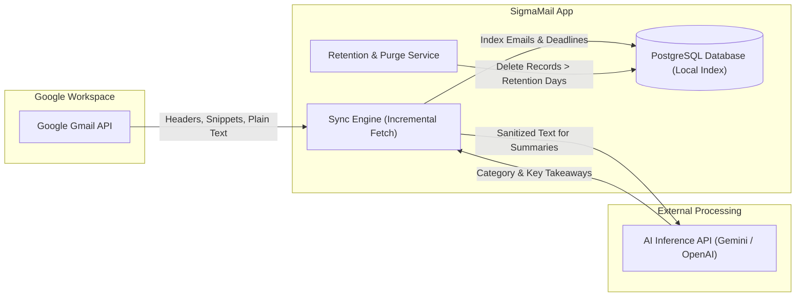

# Privacy Architecture & Data Governance: SigmaMail

**System Version:** 1.0.0-draft  
**Status:** Privacy Baseline & User Rights  
**Author:** Lead Software Architect & Privacy Officer  

---

## 1. Privacy Principles & Commitment to Students

University email accounts contain personal, academic, financial, and confidential data. SigmaMail treats student privacy with the highest level of data stewardship.

### Core Commitments:
1. **Never Sell or Monetize Student Data:** SigmaMail will never sell, rent, or trade student email content, metadata, or activity data to advertisers or third parties.
2. **Never Train Foundation AI Models on Student Emails:** Any AI processing is conducted strictly for inference (categorization, summarization, deadline extraction) using enterprise API terms with zero data retention for model training.
3. **Data Minimization:** We only fetch and store email headers, snippets, and plain-text contents necessary for organizing inbox feeds and deadlines. We do not download or store heavy attachments (PDFs, ZIPs, executables) on our servers; attachments are viewed directly via secure Google Workspace links.
4. **Right to Revocation & Erasure:** Students have complete self-service control to disconnect their Gmail account and trigger permanent deletion of all local database records with a single click.

---

## 2. Data Flow & Retention Lifecycle

### Data Storage & Retention Policy:
| Data Category | Retention Period | Storage Location | Purge Mechanism |
| :--- | :--- | :--- | :--- |
| **User Profile (Name, Email)** | Account lifetime | `User` table | Deleted upon account closure. |
| **OAuth Credentials** | Active connection lifetime | `GmailCredential` (Encrypted) | Revoked and deleted on disconnect. |
| **Email Metadata & Snippets** | Configurable (Default: 90 days) | `Email` table | Automated TTL background purge. |
| **Extracted Deadlines** | Configurable (Until academic term ends) | `Deadline` table | Dismissed or purged on term completion. |
| **Security Audit Logs** | 180 days | `AuditLog` table | Automated log rotation. |

---

## 3. Granular User Privacy Controls

SigmaMail provides a dedicated **Privacy Dashboard** (`/settings/privacy`) empowering students with granular controls:

1. **AI Processing Toggles:**
   - `Enable AI Summaries`: Toggle off to disable LLM summarization. Inbox categorization will run exclusively via deterministic heuristics.
   - `Enable AI Deadline Extraction`: Toggle off to disable automated calendar extraction.
   - `Allowed AI Provider`: Choose preferred inference provider (or select local heuristics only).
2. **Local Retention Limit Slider:**
   - Students can configure their local email retention window (30 days, 60 days, 90 days, or 180 days). Older emails are removed from the local database while remaining intact in their official Google Gmail inbox.
3. **Instant Mailbox Disconnect & Purge ("Forget Me"):**
   - Disconnecting Gmail calls the Google OAuth token revocation endpoint (`https://oauth2.googleapis.com/revoke`), revoking SigmaMail's access token and refresh token.
   - Triggers an immediate atomic database transaction cascading deletion across `GmailCredential`, `Email`, `Deadline`, and `EmailLabel` records associated with the user ID.
4. **Data Export (GDPR / Indian DPDP Act Compliance):**
   - Students can download a machine-readable JSON archive containing all their stored classifications, extracted deadlines, and audit logs.

---

## 4. Third-Party AI Data Governance

When AI classification or summarization is enabled:
- **Payload Minimization:** The prompt contains only the sender address, subject line, and the first 2,000–4,000 characters of the email body.
- **Header Stripping:** Internal routing headers (`Received`, `DKIM-Signature`, `X-Google-Smtp-Source`, IP addresses) are removed prior to AI processing.
- **Provider Terms:** SigmaMail leverages Gemini API on Vertex AI / Google AI Studio with data encryption in transit (TLS 1.3) and strict no-training guarantees.

---

## 5. Compliance with University & Google Policies

1. **Google API Services User Data Policy:** Full compliance with the "Limited Use" requirements for Restricted Scopes (`gmail.readonly`, `gmail.modify`).
2. **Indian Digital Personal Data Protection Act (DPDP Act 2023):** Ensures valid notice, verifiable consent, purpose limitation, and straightforward grievance/erasure mechanisms for Indian university students.
