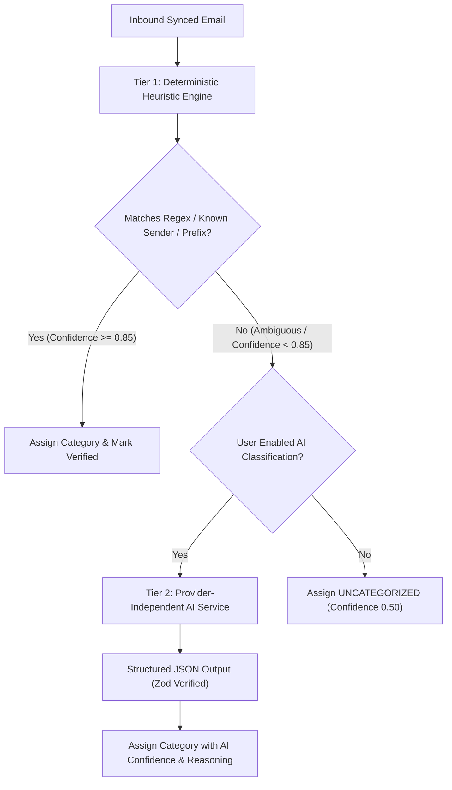
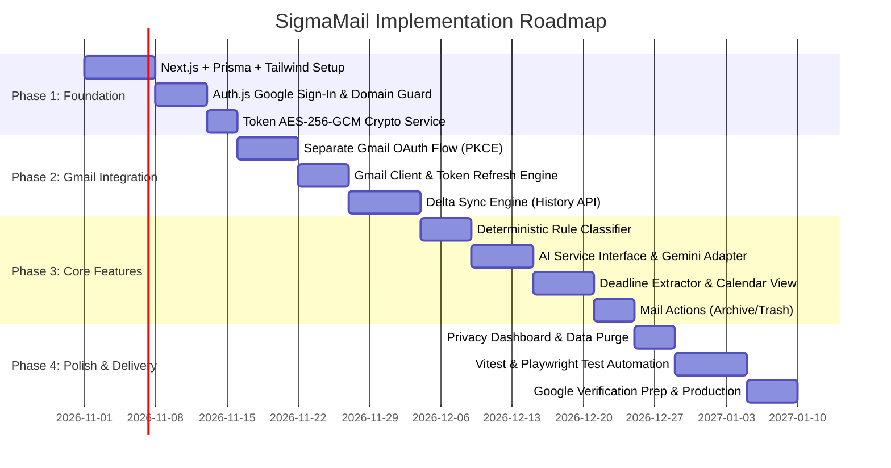

# Project Plan & Engineering Roadmap: SigmaMail

**System Version:** 1.0.0-draft  
**Status:** Project Plan Baseline  
**Target Domain:** `vitapstudent.ac.in` (Configurable via `ALLOWED_EMAIL_DOMAINS`)  
**Author:** Lead Software Architect & Senior Full-Stack Engineer  

---

## 1. Executive Summary & Goals

**SigmaMail** is a production-oriented email management platform engineered specifically for university students. Due to heavy email volume across academics, examinations, placement drives, club activities, and administrative announcements, critical academic deadlines and job application opportunities are routinely buried in standard inbox views.

SigmaMail solves this by:
1. Verifying student enrollment securely via Google Sign-In with university domain enforcement (`@vitapstudent.ac.in`).
2. Requesting separate, granular, explicit consent for Gmail reading and optional modification.
3. Classifying incoming emails automatically into targeted academic categories (Academics, Exams, Placements, Events, Administration).
4. Extracting actionable deadlines (assignments, exam schedules, registration cut-offs, placement deadlines) into an integrated calendar view.
5. Providing optional, privacy-centric AI summarization for lengthy institutional broadcasts.
6. Safeguarding student data through authenticated token encryption (AES-256-GCM), data minimization, and user-initiated erasure controls.

---

## 2. Core Functional Requirements

| Requirement ID | Module | Description | Acceptance Criteria |
| :--- | :--- | :--- | :--- |
| **FR-01** | **Domain Auth** | Google Sign-In with restricted university domain validation. | Only emails matching `ALLOWED_EMAIL_DOMAINS` are permitted; all other domains receive a secure 403 screen without token generation. |
| **FR-02** | **Mailbox Consent** | Decoupled, explicit Gmail authorization step. | Initial sign-in requests only `openid, email, profile`. Mailbox sync requires explicit user click and consent with clear scope explanation. |
| **FR-03** | **Token Security** | Encrypted token storage at rest. | Refresh tokens are encrypted with AES-256-GCM using unique IV and auth tag before database write; never exposed to frontend. |
| **FR-04** | **Sync Engine** | Resilient Gmail sync with delta fetching. | Initial sync pulls bounded recent history (e.g. 30 days / 200 emails); subsequent syncs use Gmail `historyId` cursor. |
| **FR-05** | **Categorization** | Multi-tier classification system. | Tier 1 uses fast deterministic heuristic rules (sender, subject keywords); Tier 2 uses AI with confidence scores. |
| **FR-06** | **Deadlines** | Automated deadline extraction. | Extracts dates and titles from academic and placement emails into a queryable `Deadline` database model with pending/completed status. |
| **FR-07** | **Mail Actions** | Archive and trash operations. | Supports local hide or remote Gmail modification (if `gmail.modify` granted). |
| **FR-08** | **AI Services** | Provider-independent summaries & extraction. | Abstracted via `AIServiceInterface` (Gemini, OpenAI, Mock) with token budget caps and zero-data-retention safeguards. |
| **FR-09** | **Privacy Controls** | User data governance & erasure. | Students can toggle AI features, configure local retention windows (30–180 days), or click "Disconnect & Purge" to wipe local data. |

---

## 3. Categorization Rules & Confidence Handling

Emails are classified into one of six core categories:
1. `ACADEMICS` (Coursework, digital assignments, LMS notices, syllabus updates)
2. `EXAMINATIONS` (Mid-term, final/FAT exams, hall tickets, grade sheets, re-evaluation)
3. `PLACEMENTS_AND_INTERNSHIPS` (Career development center/CDC notices, drives, shortlisted candidates, interview slots)
4. `EVENTS_AND_CLUBS` (Hackathons, cultural fests, sports, guest lectures, student chapters)
5. `ADMINISTRATIVE_AND_HOSTEL` (Hostel wardens, fee payments, bus schedules, library dues, maintenance)
6. `GENERAL_ANNOUNCEMENTS` (University-wide notices, holiday announcements)
7. `UNCATEGORIZED` (Ambiguous content requiring user review or manual tagging)

### Two-Tier Classification Pipeline:


### Confidence Handling:
- **Confidence >= 0.85:** Email is automatically organized into its assigned category folder with a "Verified Rule" badge.
- **Confidence 0.60 – 0.84:** Email is placed in the designated category with a visible "AI Suggestion" badge, allowing the student to confirm or reassign the category with one click (which updates heuristic rules).
- **Confidence < 0.60:** Stored as `UNCATEGORIZED` in a triage queue to avoid misplacing critical communications.

---

## 4. Synchronization, Rate Limiting & Retry Strategy

Gmail API enforces a user rate limit of **250 quota units per user per second**.
- `messages.list`: 5 units
- `messages.get`: 5 units
- `history.list`: 2 units
- `messages.modify`: 5 units

### Sync Architecture:
1. **Concurrency Lock:** Each user record has a `syncStatus` flag (`IDLE`, `SYNCING`, `FAILED`). New sync requests while `syncStatus === 'SYNCING'` return a 409 Conflict.
2. **Cooldown Guard:** A minimum cooldown of 3 minutes is enforced between manual student refresh triggers.
3. **Incremental Sync via Gmail History API:**
   - Stored in `GmailCredential.lastHistoryId`.
   - On sync, the server calls `users.history.list({ startHistoryId })`.
   - Only messages added, labeled, or deleted since the watermark are fetched, cutting API calls by over 95%.
4. **Exponential Backoff & Jitter:**
   - On receiving HTTP 429 (Too Many Requests) or 503 (Backend Unavailable), the sync engine retries with truncated exponential backoff ($2^n \times 1000\text{ms} + \text{jitter}$, max 3 attempts).
5. **Pagination & Batching:**
   - Fetches message metadata in concurrent chunks of 10 using `Promise.allSettled` to prevent network starvation.

---

## 5. AI Integration, Cost Governance & Failure Resilience

1. **Provider Independence:** Uses `AIServiceInterface` to decouple application logic from LLM vendors. Switching between Google Gemini, OpenAI, or local stubs requires only an environment variable change (`AI_PROVIDER`).
2. **Cost & Token Budgets:**
   - Hard daily limit enforced per user (`AI_MAX_DAILY_TOKENS_PER_USER = 50000`).
   - Summarization is performed on-demand when the student opens a long email (>1,500 characters), avoiding preemptive batch inference costs.
3. **Graceful Degradation:**
   - If the AI API is unreachable, times out (>5,000ms), or returns an error, the application falls back transparently to raw text snippets and heuristic classification without throwing 500 errors to the user.

---

## 6. Testing Strategy

| Level | Tool | Scope & Standards |
| :--- | :--- | :--- |
| **Unit Tests** | **Vitest** | - Domain validation logic (verifying `@vitapstudent.ac.in` vs invalid domains).<br>- Token encryption and decryption round-trip integrity (`CryptoService`).<br>- Deterministic heuristic classification regexes.<br>- Date/deadline extraction parsers.<br>- Strict synthetic data only (no live credentials or real emails). |
| **Integration Tests** | **Vitest + Supertest / Next Request Mock** | - OAuth callback handling and CSRF state token verification.<br>- Prisma repository operations with test database containers.<br>- Mocked Gmail API client responses using `nock` or MSW (Mock Service Worker).<br>- Mocked AI service adapters returning valid Zod-parsed payloads. |
| **End-to-End Tests** | **Playwright** | - Simulated login flow with mock Google Identity session.<br>- Disconnected Gmail state screen and Connect CTA.<br>- Filter and search navigation across categories.<br>- Responsive mobile and desktop layout rendering.<br>- Disconnect & Purge user privacy flow verification. |

---

## 7. Development & Deployment Procedures

### 7.1 Local Development Environment
1. **Prerequisites:** Node.js 20+ LTS, PostgreSQL 15+ (local or Docker), pnpm/npm.
2. **Setup Steps:**
   ```bash
   # Clone and enter workspace
   cd CampusInbox

   # Copy environment config
   cp .env.example .env

   # Install dependencies
   npm install

   # Generate Prisma client and run migrations
   npx prisma generate
   npx prisma db push

   # Seed synthetic test data
   npm run db:seed

   # Run local development server
   npm run dev
   ```

### 7.2 Production Deployment (e.g. Vercel / Railway / Cloud Run)
1. **Database:** Managed PostgreSQL (e.g., Supabase, Neon, AWS RDS) with connection pooling enabled (`pgbouncer=true`).
2. **Secrets Management:** Injected through host environment variables (Vercel Secrets / Cloud Run secrets). Never committed to Git.
3. **HTTPS & Headers:** Strict Content Security Policy (CSP), HTTP Strict Transport Security (HSTS), SameSite=Lax cookies, and X-Content-Type-Options: nosniff.
4. **Google Cloud OAuth Approval:** Production redirect URI (`https://yourdomain.com/api/auth/gmail/callback`) registered and verified in Google Cloud Console.

---

## 8. Milestone-Based Implementation Roadmap



### Detailed Milestones:
- **Milestone 1: Project Skeleton & Domain Authentication**
  - Next.js 14/15 App Router setup, TypeScript strict mode, Prisma initialization.
  - Auth.js v5 Google Sign-In with server-side validation against `ALLOWED_EMAIL_DOMAINS`.
  - 403 Forbidden screen for non-conforming domains.
- **Milestone 2: Decoupled Gmail Integration & Token Security**
  - Dedicated `/api/auth/gmail/connect` and `/callback` routes.
  - AES-256-GCM encryption/decryption service for stored OAuth tokens.
  - Connection status toggle in Settings.
- **Milestone 3: Ingestion & Sync Engine**
  - Gmail API wrapper with automatic access token refresh using stored refresh tokens.
  - Delta synchronization using Gmail `historyId`.
  - Concurrency locks, exponential backoff, and rate limit resilience.
- **Milestone 4: Categorization & Deadline Extraction**
  - Heuristic classification engine with campus-specific rules and keywords.
  - `AIServiceInterface` implementation with Google Gemini 1.5 Flash adapter.
  - Date and deadline parsing into the `Deadline` database entity.
- **Milestone 5: Interactive User Interface**
  - Dashboard layout with categorized tabs, search filter, and deadline drawer.
  - Email viewing modal/screen with on-demand AI summarization.
  - Archive, trash, and mark-as-read actions.
- **Milestone 6: Privacy, Testing & Production Hardening**
  - Disconnect & one-click local data purge ("Forget Me").
  - Vitest unit/integration test suite with synthetic fixtures.
  - Playwright E2E test flows.
  - Production readiness checklist and Google Cloud verification package.
