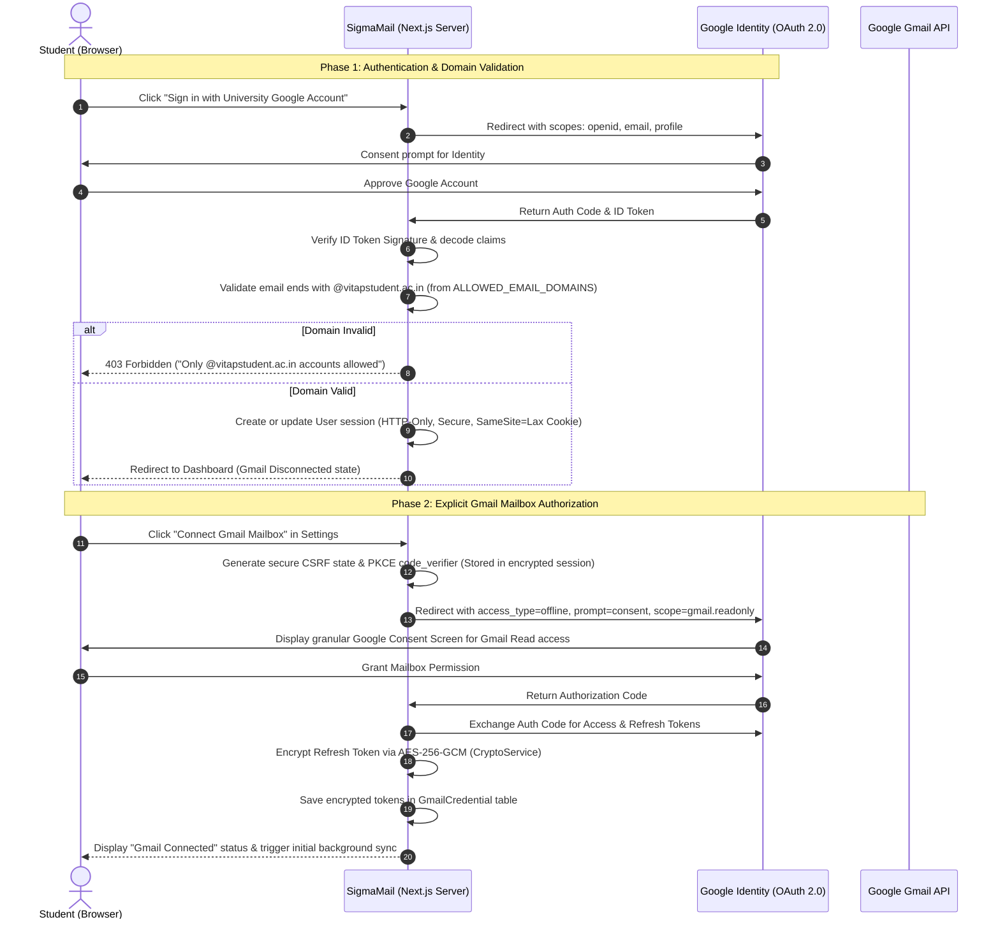

# Security Architecture & Policies: SigmaMail

**System Version:** 1.0.0-draft  
**Status:** Security Baseline  
**Author:** Lead Software Architect & Security Lead  

---

## 1. Security Philosophy & Invariants

SigmaMail handles student academic communications, which frequently include sensitive personal data (grades, disciplinary notices, hostel allocations, placement job offers, and verification codes). 

### Non-Negotiable Invariants:
1. **Never Collect or Store Google Passwords:** Authentication uses pure OAuth 2.0 / OpenID Connect token delegation.
2. **Strict Server-Side Domain Verification:** Never rely on frontend assertions for domain verification. Any domain check must occur cryptographically on the decoded Google ID token payload on the server.
3. **Decoupled Identity and Mailbox Scopes:** An identity token (`openid email profile`) does not grant and must never be conflated with Gmail mailbox access. Mailbox authorization requires separate, explicit, auditable user consent.
4. **Zero Client-Side Token Leakage:** Access tokens, refresh tokens, and internal encryption keys must never be rendered in HTML, sent in client bundles, or exposed in client responses.
5. **Authenticated Token Encryption at Rest:** All OAuth tokens (refresh tokens in particular) stored in the database are encrypted using **AES-256-GCM** with unique initialization vectors (IVs) and authentication tags per record.
6. **No Real Email Data in Testing/CI:** All tests (unit, integration, and E2E) operate strictly against synthetic, mock data factories.

---

## 2. Authentication & Separate Mailbox Consent Lifecycle



---

## 3. Cryptographic Token Storage (AES-256-GCM)

Refresh tokens and access tokens are sensitive secrets. If database backups are inadvertently leaked, plaintext tokens would allow unauthorized mailbox access.

### Encryption Protocol:
- **Algorithm:** Authenticated Encryption with Associated Data (**AES-256-GCM**).
- **Key Derivation:** Single master key `TOKEN_ENCRYPTION_KEY` (256-bit / 32 bytes hex) provided via environment variables, or derived via KMS (e.g., AWS KMS / GCP KMS in production).
- **IV (Initialization Vector):** 12 bytes randomly generated using `crypto.randomBytes(12)` for every single encryption operation. Never reused.
- **Auth Tag:** 16 bytes (128-bit) GCM authentication tag stored alongside ciphertext to prevent tampering.

```typescript
// Conceptual Implementation: lib/crypto.ts
import crypto from "crypto";

const ALGORITHM = "aes-256-gcm";
const KEY = Buffer.from(process.env.TOKEN_ENCRYPTION_KEY!, "hex");

export function encryptToken(token: string): { ciphertext: string; iv: string; tag: string } {
  const iv = crypto.randomBytes(12);
  const cipher = crypto.createCipheriv(ALGORITHM, KEY, iv);
  let encrypted = cipher.update(token, "utf8", "hex");
  encrypted += cipher.final("hex");
  const tag = cipher.getAuthTag().toString("hex");
  return {
    ciphertext: encrypted,
    iv: iv.toString("hex"),
    tag: tag,
  };
}

export function decryptToken(encrypted: string, ivHex: string, tagHex: string): string {
  const decipher = crypto.createDecipheriv(ALGORITHM, KEY, Buffer.from(ivHex, "hex"));
  decipher.setAuthTag(Buffer.from(tagHex, "hex"));
  let decrypted = decipher.update(encrypted, "hex", "utf8");
  decrypted += decipher.final("utf8");
  return decrypted;
}
```

---

## 4. Gmail Scopes & Permission Boundary Analysis

Google enforces strict tiering on Gmail scopes. Requesting unnecessary write or send access drastically increases risk, triggers complex Google App Verification audits, and harms user trust.

| Feature Area | Required Google Scope | Scope Type | Rationale & Risk Assessment |
| :--- | :--- | :--- | :--- |
| **User Sign-In** | `openid`, `email`, `profile` | **Non-Sensitive** | Identity verification only. No email content access. Minimal compliance overhead. |
| **Inbox Sync, Reading, Search** | `https://www.googleapis.com/auth/gmail.readonly` | **Restricted** | Needed to fetch messages, snippets, headers, and thread structures. Read-only prevents accidental data modification. |
| **Categorization & Priority** | *None (Local database operation)* | **Local** | Classifications and priority tags are calculated and stored internally in PostgreSQL without altering Gmail remote labels. |
| **Archive Action** | `https://www.googleapis.com/auth/gmail.modify` *(Optional)* | **Restricted** | Archiving in Gmail requires removing the `INBOX` label from the message via `messages.modify`. |
| **Trash Action** | `https://www.googleapis.com/auth/gmail.modify` *(Optional)* | **Restricted** | Trashing moves an email to Gmail Trash via `messages.trash`. |
| **Email Sending / Drafting** | `gmail.send` / `gmail.compose` | **Restricted** | **EXPLICITLY EXCLUDED.** SigmaMail does not send or draft emails on behalf of students. |

### Architectural Scope Strategy:
1. **Default Mode (Read-Only Safety):**
   - By default, the application requests ONLY `gmail.readonly`.
   - Archive and Trash actions can operate as "Local Archive / Local Hide" without modifying the remote Gmail mailbox, or:
2. **Progressive Opt-In for Remote Mailbox Modifications:**
   - If the student explicitly wants SigmaMail actions to reflect in their actual Google Gmail webmail (e.g. archiving an email also archives it on mail.google.com), the application requests `gmail.modify` as an explicit upgrade prompt in Settings, explaining the exact scope expansion.

---

## 5. Google Cloud Console & OAuth Verification Requirements

Because `gmail.readonly` and `gmail.modify` are classified by Google as **Restricted Scopes**, production deployment requires adherence to Google API Services User Data Policy:

### Development & Internal Phase:
- **Google Cloud Project Setup:**
  - OAuth Consent Screen set to **Internal** (if VIT-AP Google Workspace Admin allows internal enterprise apps) OR **External (Testing Mode)**.
  - In "Testing Mode", up to 100 specific test student emails can be manually registered in the GCP console without requiring verification.

### Production Public Phase (Google Verification & CASA Audit):
1. **Domain Verification:** Ownership verification of the production domain via Google Search Console (DNS TXT record).
2. **App Verification Assessment:**
   - Submission of a detailed YouTube demo video demonstrating why each restricted scope is required.
   - Public Privacy Policy link disclosing exact data retention, AI processing, and third-party sharing policies.
   - Commitment to the **Limited Use Requirements**: SigmaMail will not use email data for advertising, market research, or training generalized AI models.
3. **CASA Tier 2 Security Assessment:**
   - Third-party Cloud Application Security Assessment (CASA) may be mandated by Google for apps requesting restricted scopes that exceed 100 active external users.

---

## 6. Data Sanitization & Prompt Injection Defense

When processing email bodies through the optional AI engine:
1. **HTML Stripping & Truncation:** Strip all script tags, stylesheets, and embedded object binaries. Convert to clean plain-text snippet truncated to a maximum token length (e.g. 4,000 characters).
2. **Prompt Injection Boundary:** Email body content is treated as untrusted user input and wrapped in strict delimited isolation tags (e.g. `<untrusted_email_body>...</untrusted_email_body>`) with system prompts instructing the LLM to never follow instructions found within the email body.
3. **PII Masking:** Replace student registration numbers, phone numbers, and auth codes with masked placeholders prior to dispatching prompts to non-local AI models.
